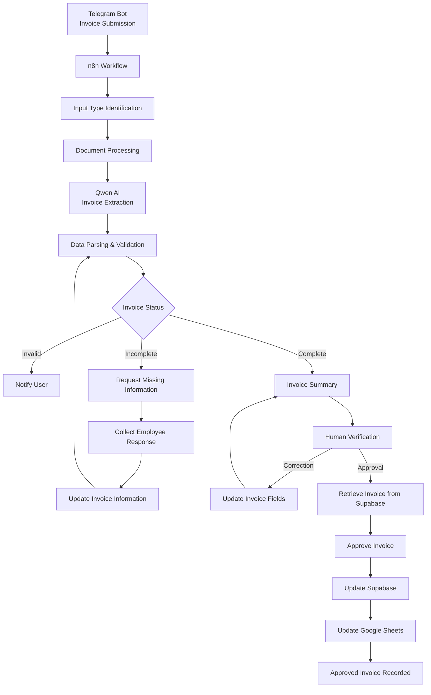
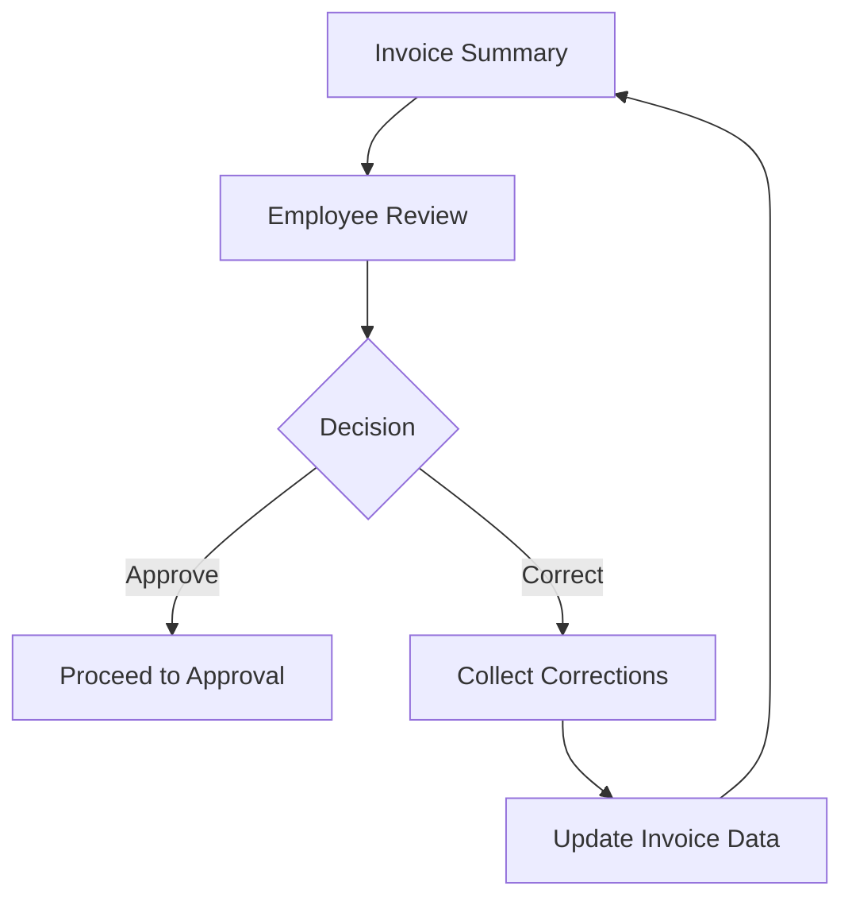

# InvoiceFlow — Invoice Processing & Management System

An intelligent, AI-powered invoice management system built with **n8n, Gemma, Qwen AI, Supabase, Telegram, and Google Sheets** that automates the invoice processing lifecycle — from document submission and data extraction to information validation, correction, human approval, and business record management.

The system transforms traditional manual invoice processing into a conversational and automated experience, reducing repetitive administrative tasks while maintaining human control over critical approval decisions.


## 📖 Project Overview

**InvoiceFlow - Invoice Processing & Management System** is an AI-powered invoice processing and approval assistant designed to simplify how businesses handle incoming invoices.

In traditional business environments, invoice management involves several repetitive activities:

1. Receiving invoices from vendors.
2. Reading and extracting invoice information.
3. Manually entering information into spreadsheets or accounting systems.
4. Identifying missing or incorrect information.
5. Contacting employees to collect missing details.
6. Reviewing and approving invoices.
7. Maintaining business records.

InvoiceFlow automates these activities through an intelligent workflow.

Employees simply submit an invoice through a Telegram bot. The system processes the document, extracts relevant information using AI, validates the extracted data, requests missing information when necessary, and presents the invoice for human verification.

Once approved, the invoice information is stored in Supabase and the business-facing Google Sheets ledger is updated automatically.

**The objective is simple: automate repetitive invoice management activities while keeping important financial decisions under human control.**

---

## 🚨 Business Problem

Invoice processing is a common administrative challenge for businesses of all sizes.

When invoice management depends heavily on manual operations, organizations may experience:

- Time-consuming invoice reading and data entry.
- Repetitive administrative work.
- Missing or incomplete invoice information.
- Delays caused by manual communication and follow-ups.
- Inconsistent invoice records.
- Difficulty maintaining an organized approval process.
- Additional workload as invoice volumes increase.

Traditional document extraction tools may solve only one part of the problem. They can extract information, but businesses still need to manage validation, corrections, approvals, and record updates.

### The actual problem

Businesses do not simply need a tool that reads invoices.

They need a system that can manage the invoice processing lifecycle.

---

## 💡 Proposed Solution

InvoiceFlow addresses this problem by combining AI-powered document understanding, conversational interaction, automated decision-making, and database integration.

The system provides an end-to-end invoice management process through a single Telegram interface.

Instead of manually handling each step, employees interact with the agent while the automation handles the underlying processing.

### How the solution works

- Submit an invoice through Telegram.
- AI reads the invoice and extracts structured information.
- The system validates the extracted information.
- Missing details are identified automatically.
- Employees provide missing information through Telegram.
- The invoice is presented for verification.
- Users can approve the invoice or request corrections.
- Approved invoice information is stored in Supabase.
- Google Sheets is updated with the approved invoice record.

---

## ✨ Key Features

### 1. Multi-Format Invoice Submission
- Accepts invoice documents through Telegram.
- Supports PDF, image, and text-based input paths.
- Provides a simple interface without requiring employees to access the n8n workflow.

### 2. AI-Powered Invoice Extraction
- Uses Qwen AI to understand invoice content.
- Extracts relevant invoice information.
- Converts unstructured document information into structured JSON.
- Organizes extracted details for further processing.

### 3. Automated Invoice Validation
- Checks whether the submitted document represents a valid invoice.
- Identifies missing required information.
- Separates incomplete invoices from invoices ready for verification.

### 4. Conversational Missing-Information Collection
- Automatically identifies missing invoice fields.
- Requests the missing information through Telegram.
- Collects employee responses.
- Updates the existing invoice information rather than restarting the entire process.

### 5. Invoice Correction
- Allows users to correct specific invoice information.
- Updates the corresponding invoice record.
- Presents the updated information for verification.

### 6. Human-in-the-Loop Approval
- Presents an invoice summary before approval.
- Allows users to review extracted information.
- Requires explicit approval before final processing.
- Keeps critical approval decisions under human supervision.

### 7. Database Integration
- Uses Supabase as the primary invoice database.
- Retrieves existing invoice records.
- Updates invoice information and approval status.
- Maintains invoice records throughout the processing lifecycle.

### 8. Automated Business Ledger
- Integrates Google Sheets for business-facing invoice records.
- Updates the ledger after invoice approval.
- Reduces manual spreadsheet data entry.
- Provides an accessible view of approved invoices.

---

## 🏗️ Workflow Architecture

The solution follows a modular architecture in which each stage performs a specific responsibility.

### High-Level Architecture



---

## 🔄 Complete Workflow Lifecycle

The workflow can be divided into seven major stages.

### Stage 1: Invoice Submission

**Entry Point: Telegram Bot**

The workflow begins when an employee submits an invoice through the Telegram bot.

The system receives the incoming message and determines the type of input.

Supported input paths:

| Input Type | Processing |
|---|---|
| PDF | Download and extract document text |
| Image | Image-processing path |
| Text | Direct text-processing path |

The incoming document is passed to the appropriate processing branch.

**Outcome:** Invoice information becomes available for AI processing.

### Stage 2: Document Processing & AI Extraction

**Core Component: Gemma & Qwen AI**

The submitted invoice is processed and passed to Gemma & Qwen AI based on the document type for information extraction.

The AI identifies relevant invoice details and generates structured output.

Example extracted information:

```json
{
  "invoice_number": "INV-2026-001",
  "vendor_name": "ABC Technologies",
  "invoice_date": "2026-11-01",
  "due_date": "2026-11-30",
  "total_amount": 25000,
  "tax": 2500,
  "discount": 500
}
```

The extracted information is then passed to a Code node.

The Code node handles:

- Parsing the AI response.
- Removing Markdown code fences when present.
- Extracting the JSON object.
- Structuring invoice information.
- Preparing data for validation.

**Outcome:** Unstructured invoice content is converted into structured invoice data.

### Stage 3: Invoice Validation

**Core Components: JavaScript Code Node & Conditional Routing**

After extraction, the system checks the invoice information.

The validation logic identifies whether the document is valid and whether the required information is available.

Example validation fields:

| Field | Purpose |
|---|---|
| Invoice Number | Identifies the invoice |
| Invoice Date | Identifies the issue date |
| Vendor Name | Identifies the supplier |
| Total Amount | Determines the invoice value |
| Tax | Records applicable tax |
| Discount | Records applicable discount |
| Due Date | Identifies payment deadline |

The required validation fields determine whether an invoice can proceed to verification.

The workflow handles three possible outcomes.

**A. Invalid Invoice**

If the submitted document is not recognized as a valid invoice, the system notifies the employee.

**B. Incomplete Invoice**

If required information is missing, the workflow identifies the missing fields and initiates a Telegram conversation to collect them.

**C. Complete Invoice**

If the required information is available, the workflow prepares an invoice summary for verification.

**Outcome:** Only invoices satisfying the required validation conditions proceed to the verification stage.

### Stage 4: Missing Information Collection

**Core Component: Telegram Interaction**

An important part of InvoiceFlow is its ability to handle incomplete invoices without requiring employees to resubmit the entire document.

Example:

An invoice contains the vendor name, invoice number, invoice date, and total amount but is missing the due date and discount.

The system identifies these missing fields and sends a Telegram message:

```text
Your invoice is missing the following information:

1. Due Date
2. Discount

Please provide the missing details.

Example:
Due Date: 30 November
Discount: 500
```

The employee responds with the requested information.

The workflow then:

1. Receives the Telegram response.
2. Identifies the requested information.
3. Updates the existing invoice data.
4. Preserves previously extracted invoice details.
5. Continues the validation process.

This ensures that the latest invoice information is retained throughout the correction process.

**Outcome:** Missing information is collected conversationally and incorporated into the existing invoice record.

### Stage 5: Invoice Verification & Correction

**Core Component: Telegram-Based Human Interaction**

Once the invoice satisfies the required validation conditions, the system sends an invoice summary to the employee.

The summary allows the employee to review the extracted information before approval.

The employee can choose between two actions.

**Option A: Approve**

If all information is correct, the employee approves the invoice.

The workflow proceeds to the approval and database update stage.

**Option B: Correct**

If any information is incorrect, the employee can request corrections.

The workflow updates the relevant invoice fields and generates an updated summary.

The corrected invoice is presented for verification again.

This creates a verification loop:



**Outcome:** Invoice information is reviewed and explicitly approved by a human before final processing.

### Stage 6: Invoice Approval & Supabase Update

**Core Component: Supabase**

After receiving the approval instruction, the workflow retrieves the corresponding invoice record from Supabase before updating it.

The approval process follows this sequence:

```text
Acknowledge Approval
        ↓
Get Invoice Before Approval
        ↓
Validate Retrieved Record
        ↓
Approve Invoice
        ↓
Update Business Sheet
```

The database operation ensures that the existing invoice record is retrieved and the appropriate record is updated.

Supabase serves as the primary database for maintaining invoice information and approval status.

The approval process is designed to update the existing invoice rather than create an unrelated new record.

**Outcome:** The invoice is marked as approved in the primary database.

### Stage 7: Google Sheets Business Ledger

**Core Component: Google Sheets**

After the approval process, the workflow updates the business-facing Google Sheets ledger.

The spreadsheet provides an accessible overview of approved invoice records.

It helps businesses maintain organized invoice information without requiring employees to manually copy details from individual documents.

The overall data flow is:

```text
Telegram
   ↓
AI Invoice Extraction
   ↓
Validation & Verification
   ↓
Human Approval
   ↓
Supabase Database Update
   ↓
Google Sheets Business Ledger
```

**Outcome:** Approved invoice information is maintained in the primary database and reflected in the business-facing ledger.

---

## 🧠 Invoice Processing Logic

The system follows a structured decision-making process.

| Condition | System Action |
|---|---|
| Invalid document | Notify employee |
| Missing required fields | Request missing information |
| Required fields available | Generate invoice summary |
| Employee requests correction | Update invoice data |
| Employee approves invoice | Begin approval process |
| Approval completed | Update Supabase |
| Database update completed | Update Google Sheets |

This conditional processing approach prevents every invoice from following the same path regardless of its condition.

---

## 🛠️ Technology Stack

| Technology | Role |
|---|---|
| [n8n](https://n8n.io/) | Workflow automation and orchestration |
| [Telegram Bot API](https://core.telegram.org/bots/api) | Invoice submission and conversational interaction |
| [Qwen AI](https://qwen.ai/) | PDF-based invoice text and structured data extraction |
| [Gemma](https://ai.google.dev/gemma) | Image-based invoice text extraction and visual document understanding |
| JavaScript | JSON parsing, data validation, and transformation |
| [Supabase](https://supabase.com/) | Primary database and invoice record management |
| [Google Sheets](https://workspace.google.com/products/sheets/) | Business-facing invoice ledger |


## 🗄️ Database & Data Management

The project uses Supabase as its primary database.

The database is responsible for maintaining invoice information throughout the processing lifecycle.

### Data Management Responsibilities

- Store extracted invoice information.
- Retrieve existing invoice records.
- Update missing or corrected information.
- Maintain approval status.
- Provide the invoice record used during final approval.

### Google Sheets Integration

Google Sheets serves as a business-facing ledger rather than the primary database.

Its responsibility is to provide an accessible representation of approved invoice records.

**Architecture principle:**

Supabase = Primary data storage.

Google Sheets = Business reporting and accessibility.

---

## 👤 Human-in-the-Loop Approval

InvoiceFlow uses a human-in-the-loop approach for financial decision-making.

AI handles document understanding, data extraction, and validation, but it does not independently make the final approval decision.

The employee remains responsible for reviewing and approving the invoice.

This approach provides:

- Human oversight.
- An opportunity to correct extraction errors.
- Greater control over financial records.
- Reduced reliance on unchecked AI-generated information.

---

## 🚀 Installation & Setup

To reproduce the project, the following services and configurations are required.

### Prerequisites

- An n8n instance (cloud or self-hosted).
- A Telegram bot created using BotFather.
- Access to a Qwen AI model/API or a compatible configured model provider.
- A Supabase project.
- A Google account with Google Sheets access.

### Step 1: Clone the Repository

```bash
git clone https://github.com/YOUR_USERNAME/invoice-agent.git

cd invoice-agent
```

### Step 2: Configure Telegram

1. Create a Telegram bot using BotFather.
2. Obtain the bot token.
3. Configure Telegram credentials in n8n.
4. Connect the Telegram Trigger and message-handling nodes.

### Step 3: Configure Qwen AI

1. Obtain access to the selected Qwen model provider.
2. Configure the required API/model credentials.
3. Connect the model to the invoice extraction workflow.
4. Configure the extraction instructions and structured JSON output.

### Step 4: Configure Supabase

1. Create a Supabase project.
2. Create the invoice table according to the fields used in the workflow.
3. Configure the Supabase credentials in n8n.
4. Set up the required retrieval and update operations.

### Step 5: Configure Google Sheets

1. Create a Google Spreadsheet for business invoice records.
2. Configure Google Sheets credentials in n8n.
3. Map invoice fields to their corresponding spreadsheet columns.
4. Connect the business ledger update operation to the approval workflow.

### Step 6: Import the n8n Workflow

1. Open your n8n instance.
2. Import the exported workflow JSON.
3. Configure the required credentials.
4. Verify node connections and field mappings.
5. Activate the workflow.

### Step 7: Test the Workflow

Submit sample invoices through Telegram and test:

- Valid invoice submission.
- Invalid document submission.
- Missing information collection.
- Invoice corrections.
- Approval.
- Supabase record updates.
- Google Sheets updates.

---

## ⚙️ Configuration

The workflow requires the following integrations to be configured before execution.

| Integration | Required Configuration |
|---|---|
| Telegram | Bot token and trigger configuration |
| Qwen AI | Model/API credentials and extraction instructions |
| Supabase | Project URL, API credentials, and invoice table |
| Google Sheets | Google OAuth credentials and spreadsheet mapping |

**Important:** Never commit API keys, bot tokens, database credentials, or other secrets to GitHub.

Use n8n's credential management and appropriate access controls.

---

## 📈 Business Benefits

InvoiceFlow provides practical value by reducing the administrative effort involved in invoice management.

| Business Challenge | InvoiceFlow Solution |
|---|---|
| Manual invoice reading | AI-powered extraction |
| Repetitive data entry | Structured data generation |
| Missing invoice details | Automated information collection |
| Manual corrections | Conversational correction process |
| Unorganized approval process | Human-in-the-loop verification |
| Manual database updates | Automated Supabase integration |
| Manual spreadsheet maintenance | Automated Google Sheets updates |

### Potential Business Impact

- Reduced repetitive administrative work.
- Faster invoice information processing.
- More consistent invoice records.
- Better visibility into invoice approval.
- Reduced manual data-entry requirements.
- A foundation for scaling invoice operations.

Actual time and cost savings will depend on invoice volume, document quality, and the existing business process.

---

## ⚠️ Limitations & Considerations

While InvoiceFlow automates several invoice management activities, certain considerations remain important for production deployment.

1. **Document Quality:** Poor-quality scans, handwritten information, or complex layouts may affect extraction accuracy.
2. **AI Accuracy:** Extracted values should always be verified before approval.
3. **Currency & Number Formatting:** Different currencies, date formats, and decimal conventions require consistent handling.
4. **Concurrent Processing:** Multiple employees submitting or correcting invoices simultaneously require proper session and record management.
5. **Duplicate Invoices:** Production deployment should include duplicate detection using invoice identifiers and vendor information.
6. **Error Handling:** API failures, database errors, and interrupted conversations should be handled through appropriate recovery mechanisms.

---

## 🔮 Future Enhancements

Potential improvements to extend the system into a more comprehensive invoice management platform:

- [ ] OCR optimization for scanned and low-quality invoices.
- [ ] Duplicate invoice detection.
- [ ] Multi-user authentication and role-based access control.
- [ ] Multiple approval levels and authorization hierarchies.
- [ ] Invoice status tracking dashboard.
- [ ] Automated payment reminders.
- [ ] Vendor management and historical invoice tracking.
- [ ] Accounting software integration.
- [ ] Advanced financial analytics and reporting.
- [ ] Audit logs for invoice modifications and approvals.
- [ ] Automated error notifications and workflow recovery.
- [ ] Invoice processing performance analytics.

---

---

## 👨‍💻 Author

**Mubtasim Saadid Ahmed**

Data Science | AI Engineering | Workflow Automation

Interested in building intelligent systems that combine AI, data, and automation to solve practical business problems.

- LinkedIn: www.linkedin.com/in/mubtasimsaadid
- Gmail: mubtasim.saadid02@gmail.com
---

## ⭐ Support

If you find this project interesting or useful, consider giving the repository a ⭐ on GitHub.
