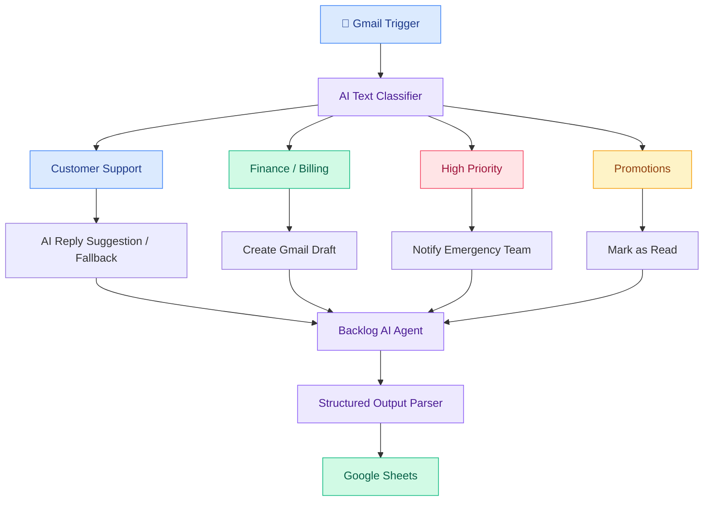

# 📧 Email Classification & Prioritization Workflow

An AI-powered email management and automation system built with **n8n**, integrating Gmail, AI agents, and Google Sheets to streamline inbox management.

The workflow automatically classifies incoming emails, triggers category-specific actions, generates AI-powered summaries, assigns priority levels, and maintains a centralized email backlog.

**Focus Areas:** Workflow Automation, AI Integration, Email Classification, Prompt Engineering, Structured Data Processing

## 🚀 Key Features

### 1. Intelligent Email Classification
Automatically categorizes incoming emails into four categories:

- 🔵 **Customer Support**
- 🟢 **Finance/Billing**
- 🔴 **High Priority**
- 🟠 **Promotions**

### 2. Category-Specific Automation

| Category | Automated Action |
|---|---|
| Customer Support | Generates AI-powered, context-aware reply suggestions. Provides fallback guidance if a suitable response cannot be generated. |
| Finance/Billing | Creates Gmail drafts for administrator review. |
| High Priority | Sends email notifications to the emergency response team. |
| Promotions | Applies the appropriate Gmail label and marks emails as read. |

### 3. AI-Powered Backlog Management

An AI agent processes classified emails to:

- Generate concise summaries of email content.
- Assign priority levels: High, Medium, or Low.
- Preserve the original email classification.
- Prepare structured records for Google Sheets.

### 4. Centralized Google Sheets Logging

Every processed email is recorded with the following information:

| Field | Description |
|---|---|
| Date/Time Received | Original email receiving timestamp |
| Sender Email | Sender's email address |
| Subject | Original email subject |
| Category | Assigned classification |
| Summary | AI-generated email summary |
| Priority | High / Medium / Low |

## 🏗️ Workflow Architecture

## 🛠️ Tech Stack

| Technology | Purpose |
|---|---|
| n8n | Workflow automation and orchestration |
| Gmail | Email monitoring and automation |
| AI / LLM Agents | Email response suggestions and summarization |
| Text Classifier | Email categorization |
| Structured Output Parser | Validating AI-generated output |
| Google Sheets | Centralized email backlog |

## ⚙️ How It Works

1. **Email Trigger:** Gmail Trigger detects incoming emails.
2. **Classification:** AI Text Classifier analyzes the email subject and content.
3. **Routing:** The email is routed to one of four category-specific automation paths.
4. **Automated Actions:** The workflow performs the appropriate action based on the category.
5. **Backlog Processing:** An AI agent generates an email summary and assigns a priority level.
6. **Output Validation:** Structured Output Parser validates the generated data.
7. **Data Logging:** Google Sheets stores the email metadata and AI-generated insights.

## 📋 Requirements

- n8n instance (cloud or self-hosted)
- Gmail account and OAuth credentials
- Compatible AI model/provider credentials
- Google Sheets account and credentials
- Emergency response team email address

## 🔧 Setup

1. Set up your n8n instance.
2. Connect your Gmail account.
3. Configure the Gmail Trigger node.
4. Set up the Text Classifier with the four email categories.
5. Configure the category-specific automation paths.
6. Connect and configure the AI agents.
7. Configure the Structured Output Parser.
8. Connect Google Sheets and map the required columns.
9. Configure the emergency notification recipient.
10. Test all four classification paths before activating the workflow.

## 💡 Business Value

- Reduces repetitive manual email sorting.
- Improves visibility into important customer requests.
- Helps prepare customer support responses.
- Streamlines finance and billing email handling.
- Ensures urgent emails receive attention.
- Creates a centralized, searchable email backlog.
- Improves email tracking and prioritization.

## 🔮 Future Improvements

- Human approval before sending AI-generated replies.
- Additional email categories such as HR, Sales, and Operations.
- Automated escalation based on urgency.
- Email response-time tracking.
- Integration with Power BI or Looker Studio for analytics dashboards.
- Advanced error handling and workflow monitoring.

## ⚠️ Important Notes

- AI-generated suggestions and drafts should be reviewed before being sent.
- Classification and priority assignments may require human verification.
- Email metadata should be mapped directly from Gmail rather than generated by AI.
- The backlog agent should preserve the original category assigned by the Text Classifier.
- Protect credentials and avoid exposing sensitive email content to unauthorized services.
